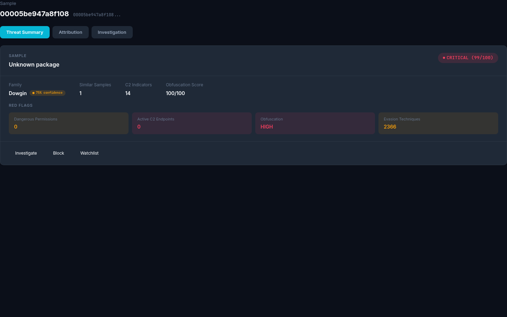

# DroidForensix

Static analysis for Android malware. It pulls command-and-control (C2) infrastructure and attributes malware families from an APK's bytecode, without running the app.

[](https://github.com/DarshakPatel2004/Droidforensix/actions/workflows/test.yml)


- **Holdout results (300 APKs):** https://droidforensix.vercel.app. The dashboard runs locally, see [Quick start](#quick-start).
- **Author:** [Darshak Patel](https://github.com/DarshakPatel2004) (MSc Digital Forensics, NFSU Delhi)

---

## Honest numbers first

Read these before quoting any headline figure.

| Measure | Result | Notes |
|---|---|---|
| Malware vs. benign, 300-APK holdout | **97.3%** accuracy (292/300; 95% CI 94.8–98.6%) | Static only, no LLM, threshold 0.7. The split is confounded (see below) and is not evidence of general accuracy |
| Family identification, exact match | **64.2%** (226/352), in-sample | 198 of the 352 predictions come from a knowledge base mined from the same ground truth. Leak-free dev baseline: 35.5%. On unseen LAMDA families: 0/51 correct |
| Confirmed genuine C2 | **Not measured** | An earlier "2.4% (9/380)" figure was wrong. Those 9 entries are heuristic flags (TLD and DNS checks) from 22 samples, not confirmed C2 |

Raw indicator counts measure extraction coverage, not verified accuracy. Most extracted indicators are benign. Treat family output as advisory.

The family evaluation uses the 352-sample corrected ground truth (`ground_truth_all_corrected.csv`) and is in-sample, as noted above. Raw review data is in `evaluation_results/`.

### Malware vs. benign classifier

A 15-feature random forest scores each APK from static features only. The retrained model (`evaluation/malben_eval/malben_rf_retrained.pkl`) is not yet committed, and the CLI's default model is the older `evaluation/classifier_data/malben_rf.pkl` at threshold 0.5. Results below use the retrained model at threshold 0.7.

- **Training:** 509 original APKs, plus 100 added in the retrain.
- **Threshold:** 0.7, chosen on a separate 100-APK validation split (98% accuracy, 0 benign flagged). The retrain raised validation AUC from 0.9816 to 0.9944.
- **Holdout:** 300 APKs (150 malware, 150 benign). No hash overlaps with the training or validation data, and the holdout was not used for tuning.
- **Confound:** all 150 malware samples come from the 2010–2012 Drebin list, and all benign apps are current F-Droid apps. A file-size-only baseline reached 88.5% on a same-source split in our audit. The 97.3% therefore partly reflects an easy, source-confounded split.
- **Result:** 292/300 correct. 4 malware missed, 4 benign flagged. Report: `evaluation/malben_eval/run_fresh_t070/report.json` (not yet committed).
- **Earlier pilot:** a 20-APK pilot scored 55% (11/20) before the retrain. Details are in [evaluation/FRESH_CORPUS_RESULT.md](evaluation/FRESH_CORPUS_RESULT.md).

Treat 97% as a result for this corpus and this split, not a general accuracy claim. A same-source, balanced-by-collection-date holdout is needed before quoting it as general accuracy.

---

## What it does

```
APK → Androguard + apktool (manifest, DEX, strings) → decoding → C2 extraction
    → correlation → LLM assessment → family attribution → pipeline_result.json
Dashboard → threat intel (VT, OTX, Shodan, Censys) → geolocation → report
```

The analysis is an 18-step pipeline in `analysis/step1_*.py` … `step18_*.py`. It covers manifest and permission extraction, string decoding, C2 extraction, LLM threat assessment, packer detection, native library analysis, certificate analysis, family clustering, and report synthesis. The output is a single `pipeline_result.json` per sample.

Family attribution runs in three layers:

1. **Hand-written signatures** (`signature_v3`). Precise, but cover only some families.
2. **Knowledge-base matcher** mined from corrected ground truth, with false-positive control on anchor tokens.
3. **LLM verdict** over the signals that actually matched. It picks from candidate families and does not free-generate one.

A packer module handles entropy and DEX-structure heuristics, plus unpacking for supported packers. It is static, with no emulator.

---

## Quick start

**Prerequisites:** Python 3.10+, Node.js (for the dashboard), Git. Optional: [Ollama](https://ollama.com) for local LLM assessment, and API keys for threat-intel feeds.

```bash
git clone https://github.com/DarshakPatel2004/Droidforensix.git
cd Droidforensix

python -m venv .venv
.venv\Scripts\activate          # Windows
# source .venv/bin/activate     # Linux/macOS

pip install -r requirements-lock.txt   # pinned versions
cp .env.example .env                   # add API keys as needed
```

Run the full pipeline headless:

```bash
python -m analysis.pipeline path/to/sample.apk
# → analysis/work/<sha256>/pipeline_result.json
```

Run the web app:

```bash
python -m backend.main           # API on http://localhost:8000
cd frontend && npm install && npm run dev   # dashboard on http://localhost:5173
```

Other entry points: `python -m droidforensix analyze|classify|serve|unpack <apk>`. Setup details, including the external tools in `tools/`, are in [docs/SETUP.md](docs/SETUP.md).

### Sample output

Trimmed from a real `pipeline_result.json`:

```json
{
  "sample_id": "0156094f7785b899b15150f449f7f2874c2c9b642ff0651176143077b11af99a",
  "metadata": { "file_size_bytes": 6042879 },
  "secret_risk": {
    "severity": "high",
    "total_secrets": 3,
    "by_severity": { "medium": 2, "high": 1 },
    "risk_score": 9
  },
  "hardcoded_secrets": [
    { "secret_type": "google_oauth_client_id", "severity": "medium", "source": "dex" },
    { "secret_type": "firebase_url", "severity": "medium", "source": "res/values/strings.xml:firebase_database_url" },
    { "secret_type": "google_api_key", "severity": "high", "source": "res/values/strings.xml:google_api_key" }
  ],
  "c2_infrastructure_count": 5
}
```

---

## Dashboard



| View | What it shows |
|---|---|
| Glance | Threat summary: score, family, red-flag indicators |
| Family attribution | Primary match, confidence bars, related samples |
| Dissection | Manifest, permissions, components, code, strings, DEX entropy, native libraries |
| Threat chains | Interactive viewer with decoders (Base64, hex, URL, XOR) |
| Threat intel | MITRE ATT&CK mapping, VT/OTX hit counts, Shodan host profiles |

Full guide: [docs/dashboard-guide.md](docs/dashboard-guide.md).

---

## Testing

```bash
# Backend (CI runs Python 3.10)
pytest tests/ -q
pytest tests/ -q -m "not slow"     # skip tests that need JADX or other external tools

# Frontend
cd frontend && npm test && npm run lint && npm run build
```

CI runs pytest, `ruff check`, and the frontend build on every push and pull request. The Python suite has 966 tests in 72 files. The frontend has 45 test files.

---

## Layout

```
analysis/   18-step pipeline (the source of truth)
backend/    FastAPI app that reads pipeline output; family attribution
frontend/   React + Vite dashboard
droidforensix/  command-line entry points
scripts/    unpacking, dissection, batch utilities
evaluation/ evaluation harness and validation scripts
evaluation_results/ committed validation results
data/      GeoIP databases, YARA rules, packer markers
docs/       usage, API, architecture, packers, performance
tests/      pytest suite
```

The backend and dashboard only read the pipeline output. Detection logic lives in `analysis/`. Root-level `.py` files such as `batch_classify.py` are one-off research tools, not the product path.

---

## Documentation

- [Usage](docs/USAGE.md): install, run, troubleshoot
- [API reference](docs/API.md): REST and WebSocket endpoints
- [Architecture](docs/ARCHITECTURE.md): layers, modules, ML artifacts
- [Packers](docs/PACKERS.md): packer matrix and how to add one
- [Performance](docs/PERFORMANCE.md): baseline and hotspots
- [Codebase reference](docs/codebase-reference.md): module-by-module tour
- [Audit, 2026-11-11](docs/AUDIT_2026-11-11.md): known bugs, risks, and the fix order

---

## Configuration

Copy `.env.example` to `.env`. Keys are optional unless you use the matching feature.

| Variable | Purpose |
|---|---|
| `NVIDIA_NIM_API_KEY` | NVIDIA NIM LLM backend |
| `OLLAMA_HOST` | Local Ollama endpoint |
| `OPENROUTER_API_KEY` | OpenRouter LLM backend |
| `VT_KEY`, `OTX_KEY`, `SHODAN_KEY`, `CENSYS_TOKEN` | Threat-intel feeds |

Never commit `.env` or paste its values into code or issues.

---

## Responsible use

The pipeline is built to analyze malware safely. It never runs the sample. Still, treat the samples as hostile:

- Work on an isolated machine or VM, and keep APKs out of shared folders.
- Keep `.env` and the API keys in it out of version control and out of screenshots.
- Use the outputs for defense, research, and education. Do not use them to build or tune malware.

## Limitations

- **Indicator precision is low.** Heuristics favor recall. Expect most extracted indicators to be benign.
- **Family attribution is imperfect.** Opaque-obfuscation families (Opfake, FakeChrome) leave few static signals. Toolkit-shared families (TeaBot, Hydra, Ermac, FluBot) are hard to tell apart.
- **Reflection-heavy and encrypted native code** is handled by heuristics and often needs manual inspection.
- **C2-blind samples** (no static artifacts) cannot be analyzed statically. This is a known gap.

## Roadmap

- Multi-sample attribution clustering (Threat Synthesis Engine), planned Q1 2027
- Frida-based runtime confirmation of static C2 candidates, planned Q2 2027
- Cipher.doFinal tracing for string-decryption correlation

---

## Contributing

Issues and pull requests are welcome. Before opening a PR, run the same checks as CI:

```bash
ruff check analysis backend droidforensix tests
pytest tests/ -q
cd frontend && npm test && npm run build
```

## License

No license has been chosen yet, so there is no LICENSE file in the repository.
