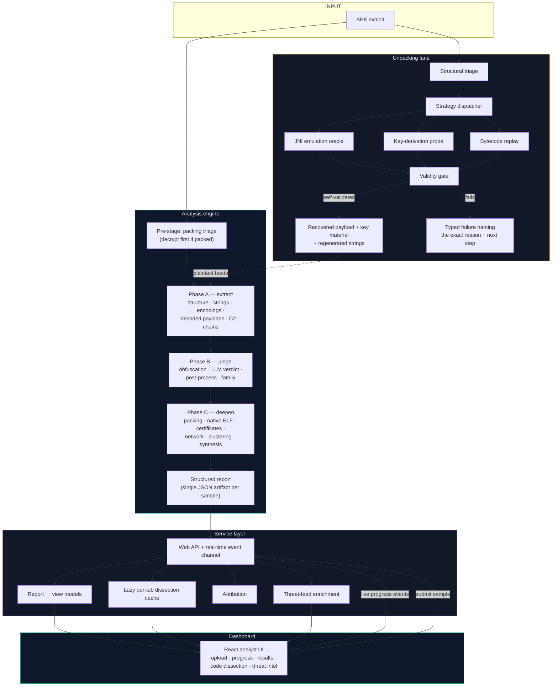
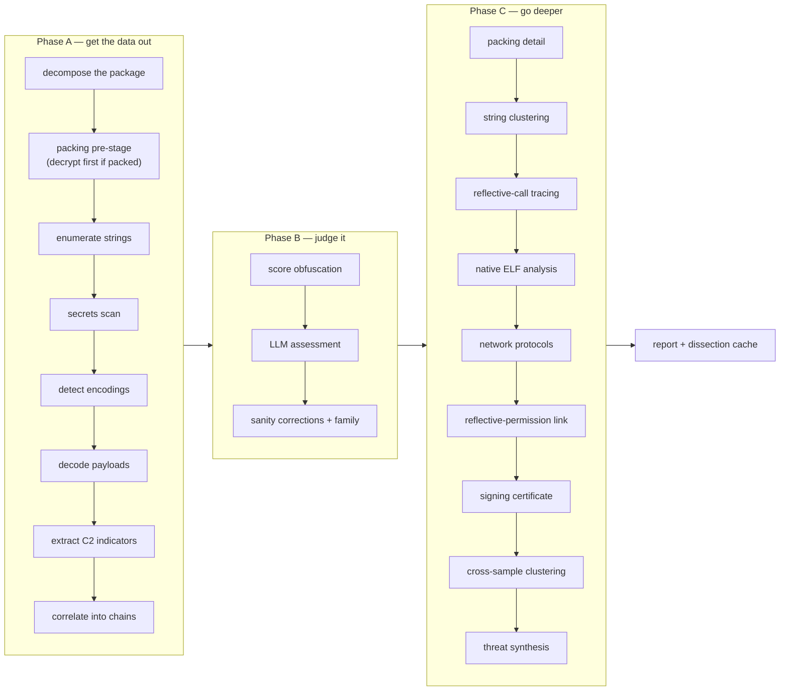
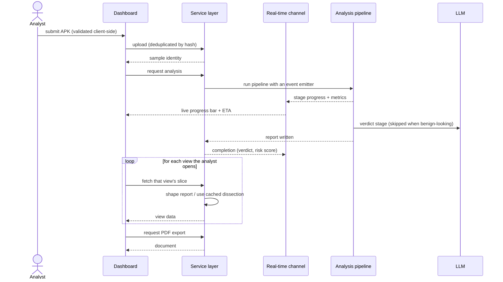
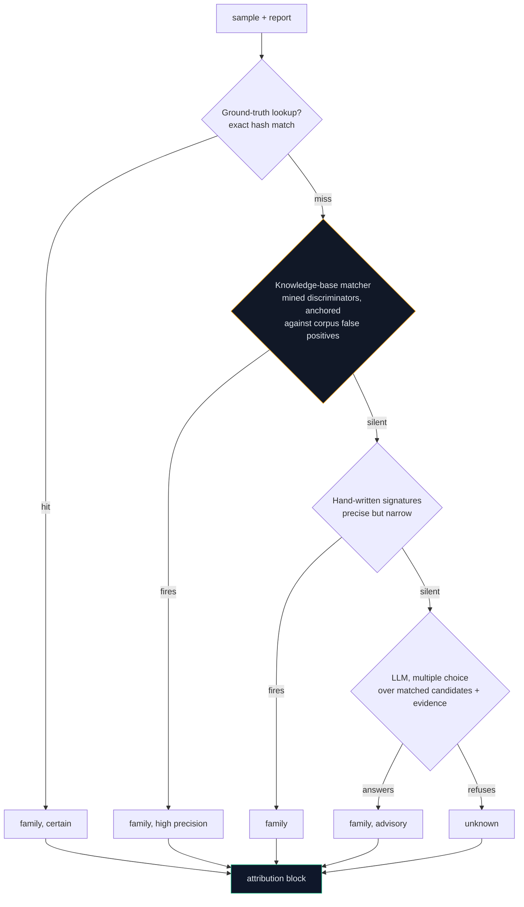
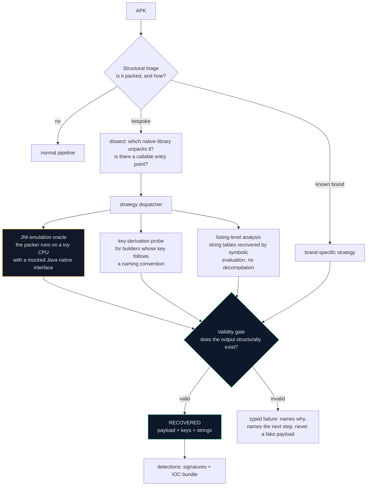
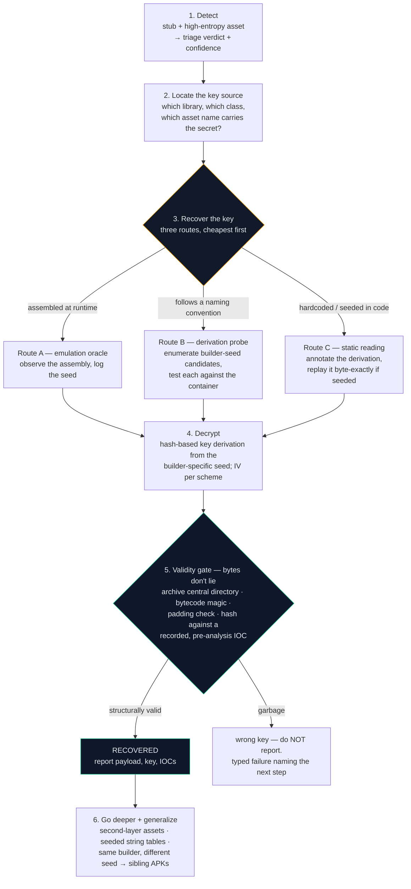
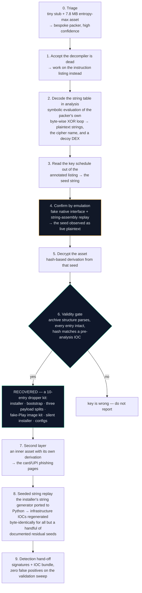

# DroidForensix — How The Whole Project Works

> **Purpose.** A plain explanatory tour of the system: what it is, how an APK
> travels through it, how encrypted/packed samples get opened up, and what the
> measured results are. Read top to bottom and you will understand the project.
>
> **Scope of this document.** Explanatory, not a build guide, and deliberately
> self-contained — it refers to nothing else. Exact commands, file paths,
> function names, tuning parameters, and key-derivation formulas are not
> included. What *is* here: the architecture, the method, the reasoning behind
> each design choice, and the honest numbers.
>
> **Contents:** [1](#1-the-one-paragraph-version) ·
> [2](#2-system-map) · [3](#3-the-analysis-pipeline) ·
> [4](#4-backend--dashboard) · [5](#5-family-attribution) ·
> [6](#6-the-unpacking-lane) · [7](#7-how-we-attack-an-encrypted-apk) ·
> [8](#8-case-study-the-encrypted-banker) · [9](#9-what-the-system-produces) ·
> [10](#10-the-honest-numbers) · [11](#11-running--testing) ·
> [12](#12-known-boundaries)

---

## 1. The one-paragraph version

DroidForensix is an **Android malware static-analysis system**: it takes an APK,
never executes it, and produces a structured threat report. A decompilation
layer breaks the package apart; an **18-stage pipeline** extracts strings,
unwraps obfuscated encodings, pulls out command-and-control (C2) infrastructure,
scores obfuscation, and asks an LLM for a verdict; a web **service layer**
converts that report into a REST + real-time API; a **React dashboard** renders
it for the analyst. Alongside the routine pipeline sits a second, deeper lane —
an **unpacking subsystem** that statically recovers payloads hidden behind
encryption and packing, without a device or an emulator (§6–§8). Everything is
reproducible from committed code; recovered evidence and key material are kept
out of version control by design.

---

## 2. System map

**The load-bearing invariant:** the service layer and dashboard are *viewers*.
All detection logic lives in the analysis engine and the unpacking lane — the
API aggregates and shapes, it never re-decides what a sample is.

### Where things live

| Area | Role |
|---|---|
| Analysis engine | The staged pipeline, ML classifiers, family knowledge mining, cross-sample clustering |
| Service layer | Web API, orchestration, attribution, lazy dissection, threat-feed aggregation, report export |
| Dashboard | React UI over the REST + real-time API |
| Research tooling | Packer triage/dissection/emulation, dataset and ground-truth tooling, batch drivers |
| Data & models | Offline geolocation database, packer marker signatures, allowlists, trained classifiers |
| Tests | A backend suite and a separate frontend component suite, both in CI |
| Case material | The worked reverse-engineering case study and its evidence (partly local-only) |

---

## 3. The analysis pipeline

One entry point runs every stage in order, each with its own timeout and each
validating its predecessor's output before proceeding. Progress is streamed as
events (`step started`, `step completed`, `metric updated`) so the dashboard can
draw a live progress bar with an ETA. The single output artifact — one JSON
report per sample, keyed by the sample's hash — is what every downstream view
reads. Nothing downstream re-analyzes the APK.

**What each phase is for**

- **Phase A** turns bytes into evidence: decomposition → string enumeration with
  entropy and framework-noise filtering → encoding detection (base64, hex, XOR
  and friends, with a false-positive filter) → decoding → C2 indicator
  extraction with an allowlist of known-benign infrastructure → correlation into
  directed *threat chains* (encoded string → decode step → artifact → endpoint),
  each chain carrying a composite confidence.
- **Phase B** judges: an obfuscation score built from signals (reflection,
  dynamic loading, encrypted assets, native oddities) feeds an LLM verdict —
  which is sanity-checked against the actual indicators and falls back to rules
  if the model is unavailable — then a post-processing pass applies known
  corrections (missed stagers, benign false positives, suspicious package names)
  and family attribution runs.
- **Phase C** deepens: binary packing detail, string clustering for decryption
  correlation, reflective-call tracing, native ELF analysis, network protocol
  analysis, linking reflective calls to the permissions they actually need,
  certificate analysis, cross-sample family clustering, and finally a
  synthesized threat-intelligence profile that consumes every earlier stage.

**Design behaviours worth knowing**

- Each stage degrades rather than dies: failures are wrapped so one broken stage
  blanks its own field instead of killing the run.
- The LLM stage is optional and *skipped* for samples that look benign under a
  cheap pre-filter — roughly 40% of a typical corpus, about a 2× speedup.
- Very large APKs can drop the heaviest string stages in a degraded mode.
- Every stage is individually runnable for debugging.

---

## 4. Backend + dashboard

Three properties make this pleasant to use:

1. **Uploads are idempotent** — the sample's hash is its identity, so
   re-submitting an already-analyzed APK returns the existing report instead of
   re-running anything.
2. **Progress is pushed, not polled** — the pipeline emits events over a
   WebSocket; the frontend renders them directly, with exponential-backoff
   retries and keepalive pings so a dropped connection recovers on its own.
3. **Heavy views are lazy and cached** — the structural dissection behind the
   manifest/permissions/components/strings/code tabs is computed on first open
   and cached with a TTL, so opening a sample never pays the full extraction
   cost twice.

---

## 5. Family attribution

*"Which malware family is this?"* is answered by layered voters rather than one
model, because a single model is easy to fool and hard to debug.

- **Deterministic layers win over the model.** The LLM is only consulted when
  the deterministic layers are unsure, and it is shown *candidate families with
  the signals that actually matched* rather than asked an open question — that
  framing was the difference between a model that refused to answer most
  samples and one that answers reliably.
- **Knowledge-base discriminators are mined from corrected ground truth** and
  anchored: a token only counts if it is rare in the wider corpus, which keeps
  the false-positive rate down.
- **Samples whose payload we could not open are never guessed** — attribution
  returns "unknown" with the reason, so accuracy metrics count them honestly
  instead of rewarding a lucky guess.
- Ground truth was re-verified externally sample-by-sample before any of these
  numbers were computed.

---

## 6. The unpacking lane

The pipeline answers *"what does this APK do?"*. This lane answers a harder
question: **what is this APK hiding behind encryption, and can we recover it
without ever running it?**

The operating doctrine:

> Don't run the malware. Make it run itself inside a fake world, then write
> down every secret it touches.

**The three recovery techniques** (the project's core contribution, the
"hybrid static blueprint"):

| Technique | What it does | When you need it |
|---|---|---|
| **Listing-level symbolic evaluation** | Walks the raw instruction listing and evaluates the packer's own byte-wise string decoding in analysis, recovering embedded string tables without executing anything | When control-flow flattening defeats every decompiler |
| **JNI emulation oracle** | Runs the packer's real native decoder on a toy CPU with a mocked native-interface table; every call it makes is logged and Java string assembly is replayed, so a key assembled at runtime appears as readable plaintext | When the key never exists on disk in one piece |
| **Bytecode replay** | Ports a packer's string-derivation routine straight from Dalvik bytecode into ordinary Python and regenerates the string table offline | When strings come from a seeded generator rather than a constant table |

**The contract that matters:** a run always ends in either *recovered* — meaning
the artifacts passed a structural validity gate — or a *typed failure* that names
exactly why and what to try next. The system never fabricates a payload, and
never reports bytes it cannot prove are a real file. That single rule is what
makes the output usable as evidence.

Detection signatures and IOC bundles produced from the lane anchor on **build
architecture, not on infrastructure** (domains rotate; a builder's structure
doesn't), which is why they survive operator rotation.

---

## 7. How we attack an encrypted APK

The repeatable playbook, independent of any one sample. §8 is the worked
example; this is what you would do to the *next* encrypted APK.

### 7.1 Recognising "encrypted" rather than merely "packed"

You are probably facing an encrypted payload when **all** of these hold:

| Smell | Where you see it |
|---|---|
| The on-disk code file is a tiny stub whose only job is to load a native library | String enumeration returns nothing useful — no C2, no package names |
| One oversized asset with a random-looking name and near-maximum entropy | Structural triage flags it: *bespoke packer, high confidence* |
| Standard indicator extraction finds nothing | The defining smell — nothing to extract until the payload is opened |
| All the real logic sits in a single native library | Dissection points at it as the unpacker |

Entropy and structure tell you it is *packed*. They do not tell you the crypto —
that needs the next step.

### 7.2 The core insight: the key is never on disk

> **The combination is not written anywhere.** The sample *assembles* it at
> runtime — frequently inside deliberately scrambled native code that
> decompilers cannot process at all.

Two consequences that shape the whole method:

1. **Blind key search is the wrong first instinct.** An early exhaustive sweep
   failed not because the key was wrong but because the *validation* method was
   wrong — it rejected the correct key. Fixing the validation, not widening the
   search, is what cracked it.
2. **We never break the lock — we watch the thief unlock it.** The sample
   carries its own key and does its own crypto; we let *it* perform the
   decryption inside an environment we fully control and record every secret it
   touches. **Nothing ever runs on a phone.**

### 7.3 The six-stage method

### 7.4 Where keys actually come from

| Key source | How we read it |
|---|---|
| **Assembled at runtime** in native code from fragments, then hashed | The emulation oracle replays the assembly and the seed appears as plaintext |
| **Derived from an asset or file name** by convention, with no key string anywhere in the binary | Enumerate builder-seed candidates from the name, derive, and test against the container's structure |
| **Hardcoded in the Java layer** in a decryption helper | Read the code, port the derivation, and verify it independently against a second artifact |
| **A seeded generator feeding a string table** | Replay the generator offline, byte for byte |

The recurring shape: a **short, builder-specific seed** goes through standard
hash functions to produce the key and IV. Only the seed differs per builder —
which is exactly why breaking one APK usually breaks its siblings (§8).

### 7.5 Rules we don't bend

1. **Decryption proves nothing on its own.** A wrong key also produces bytes.
   Only structural validity plus an **independent hash recorded before the
   analysis** turns bytes into evidence.
2. **Use a negative control.** Apply the wrong sibling derivation and show it
   fails — that is what rules out a lucky match.
3. **Never fabricate a recovery.** If emulation faults, return a typed failure
   that names the failure and the next step. Not a garbage payload.
4. **Read-only on the exhibit.** The APK is never modified; hashes are the
   chain-of-custody anchor.
5. **Key material never ships in public artifacts.** Write-ups carry the
   derivation *shape*, re-derivable in one line; the values live in local-only
   evidence files.
6. **Runtime-delivered stages stay undelivered.** If a payload is fetched from
   live criminal infrastructure, we document the delivery path and the scheme —
   we do not touch live infrastructure.

### 7.6 Where it plugs into routine analysis

The unpacking lane is wired into the main pipeline as its pre-stage: triage →
attempt decryption → on success, merge the recovered plaintext into the string
set so indicator extraction and family attribution see real text (this is what
rescues otherwise-opaque families) → on a typed failure, tag the sample so
attribution answers "unknown" with a reason instead of guessing.

---

## 8. Case study: the encrypted banker

> This section summarises the case. The file-by-file evidence chain, the
> per-artifact walkthrough and the full reproducibility recipes are outside the
> scope of this document.

### 8.1 The target

| Property | Value |
|---|---|
| Sample | `RTO.apk` — an 8.1 MB, live 2026 sample |
| Family | BeatBanker / BTMOB cluster — fake Indian e-challan phishing, XMR miner, silent install |
| What it does | A decoy app on the surface; the real payload is a 7.8 MB encrypted blob in the assets |
| Why it is hard | The decryption key never exists on disk; it is assembled inside one ~36,000-instruction, control-flow-flattened native function |

Two dead ends forced the approach:

1. **The decompiler cannot handle it.** The native function is flattened into
   giant straight-line blocks of tens of thousands of byte operations; Ghidra's
   decompiler times out even on isolated 1 KB slices. The cause is structure,
   not size.
2. **Running it naively shows only a decoy.** The sample fingerprints its
   environment and gates the real loader behind a runtime flag, so an ordinary
   emulator run executes a fake accelerometer app and stops.

### 8.2 The break

### 8.3 What the recovery proved

- The key was **observed being assembled**, not guessed — two independent
  routes (original p-code emulation and the shipped oracle plus derivation
  probe) agree.
- The decrypted container **parsed as a valid archive and its hash matched an
  IOC recorded before the tooling existed** — no drift, no re-derived
  coincidence.
- The kit contained a **crypto-miner installer, a card/UPI phishing kit behind a
  second encryption layer, and a permission-bypassing silent installer**.
- The second layer was broken by a *different* derivation, and a **negative
  control** — the first layer's derivation applied to it — provably fails, which
  rules out a lucky match.
- Seeded string replay regenerated the infrastructure strings **byte-identically
  for 175 of 180 seeds**, the residuals documented individually as ground-truth
  labeling artifacts rather than silently ignored.
- The same builder's derivation family unlocked **five more seized APKs** into
  byte-identical kits — the break is a property of the *builder*, not one lucky
  sample.
- Detection signatures built from the findings produced **zero false positives**
  across a sweep of benign and unrelated-malware APKs.

### 8.4 Honest boundaries of the case

- Payloads delivered at runtime from live infrastructure were documented, not
  fetched.
- The 32-bit twin of the native library is structurally confirmed but not fully
  emulated — it carries layered anti-disassembly; the crypto is shared code
  proven in the 64-bit build.
- The original function was never *decompiled* — it was evaluated.

---

## 9. What the system produces

| Output | What it is |
|---|---|
| Structured report (JSON) | The whole analysis for one sample: metadata, extraction, indicators, chains, obfuscation, verdict, attribution, synthesis, timings |
| Dissection cache | Structural views — manifest, permissions, components, DEX stats, classes, strings — computed on demand |
| PDF report | Analyst-facing document: assessment, indicator table, threat-intel enrichment, and a methodology note explaining the risk scoring |
| STIX / CSV / YARA exports | Machine-readable hand-off formats for the threat-intel view and third-party tooling |
| Detection bundle | Signature rules + IOC bundle (hashes, network indicators, configuration artifacts, crypto derivations) |

**Git vs. evidence rule:** tooling, tests and write-ups are version-controlled;
recovered payloads, key material and raw traces are **local-only** and handed
over separately. Public documents carry derivations and hashes, never secrets.

---

## 10. The honest numbers

| Metric | Value | Caveat |
|---|---|---|
| C2 indicators extracted | 1,711 across 277 samples, 12 countries | an **extraction** count, not verified accuracy |
| Indicator precision (manual review of 380 indicators) | **2.4% confirmed malicious, 68% clearly benign** | heuristics favour recall by design |
| Family identification (352-sample corrected ground truth) | **64.2%** exact match (68.6% on specific families) | treat as advisory |
| Recall on a balanced set | 95% | after a filter regression was found and fixed |
| Throughput | **63× faster than manual** analysis | ~1.5 min/sample with the LLM, ~0.4 min when skipped |

These figures are committed with their validation data and can be recomputed
from the repository's evaluation harness. The project deliberately publishes the
weak numbers alongside the strong ones: indicator extraction is high-recall /
low-precision, and most false positives are legitimate Google/Firebase/CDN
infrastructure.

**What was learned the hard way** (worth knowing if you extend this):
an LLM called synchronously per sample was the original bottleneck — fixed with
a cheap pre-filter; an aggressive string filter quietly destroyed recall —
found by validation and rolled back; sequential threat-feed queries were
pointless — parallelizing them cut enrichment from seconds to under a second.

---

## 11. Running & testing

Operationally the system is three cooperating processes:

1. **An LLM backend** (local by default, cloud providers optional) for the
   verdict and attribution layers,
2. **the API service**, which owns the pipeline and the report store,
3. **the dashboard**, served by a dev server.

The same pipeline is runnable headless as a single command on an APK, writing
its report to disk — the API is a viewer over that artifact, not a requirement.

Testing: a backend suite (pytest) and a frontend component suite (Vitest),
both wired into CI on every push. Setup, troubleshooting and configuration are
outside the scope of this document.

---

## 12. Known boundaries

Stated up front so nobody over-reads the output:

- **Static only.** No execution, no emulator, no dynamic confirmation — malware
  with zero static artifacts is a documented blind spot.
- **Indicator extraction is high-recall / low-precision.** Most false positives
  are legitimate infrastructure; a low single-digit percentage survived manual
  review as genuine C2.
- **Family identification is advisory** at 64.2%; opaque-obfuscation families
  and families built on shared toolkits remain hard even for human analysts.
- **The emulation oracle is native-interface layer by design.** Java-only
  unpackers are answered with a typed "out of scope" result instead of a
  fabricated payload; packers that register their natives at runtime get a typed
  failure naming the next technique to try.
- **Runtime-fetched stages stay runtime-fetched** — documented, never pulled.
- **Residual replay seeds are documented individually** and pinned by a test —
  not silently ignored.

---

*Explanatory edition — this document is self-contained. Implementation
specifics (commands, paths, parameters, acceptance bars, key derivations) are
intentionally not included.*
