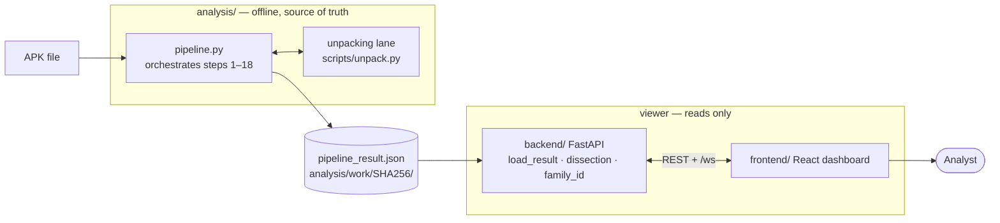
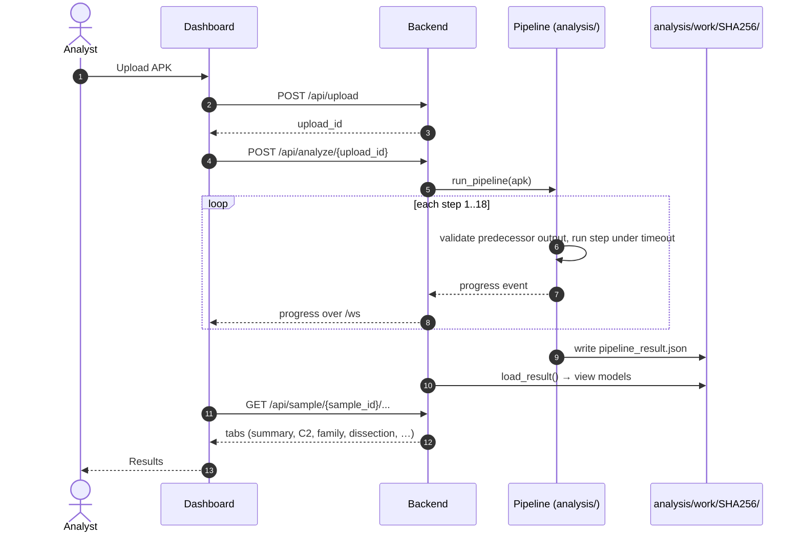
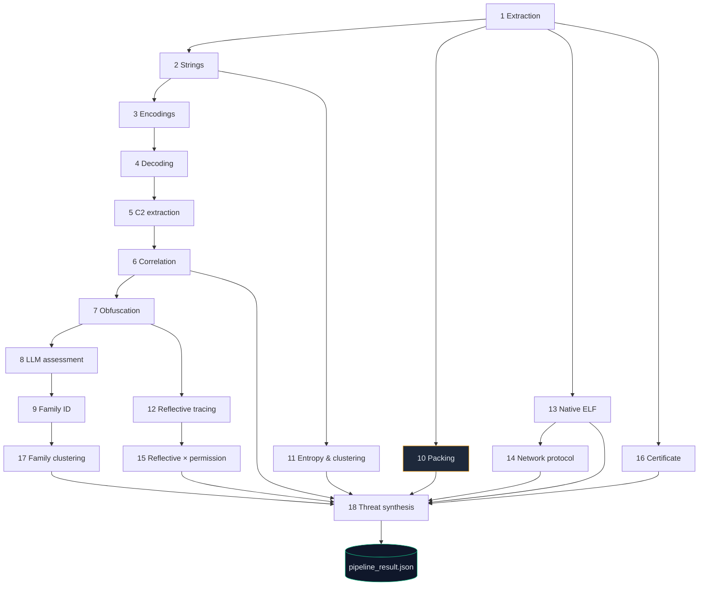
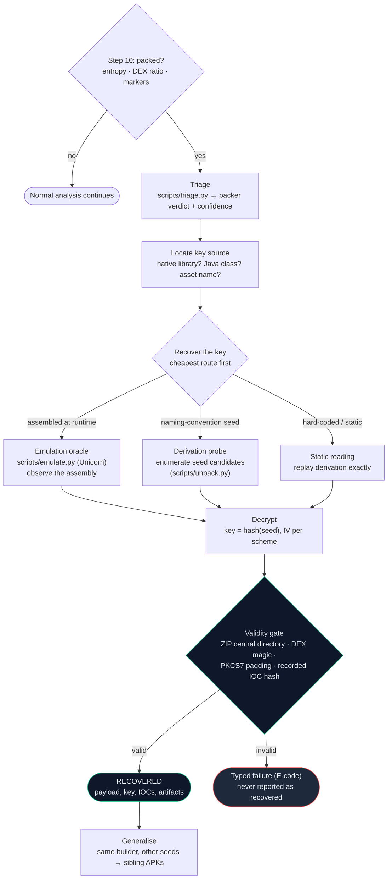
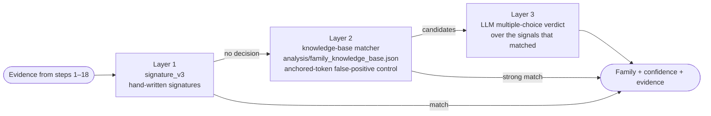
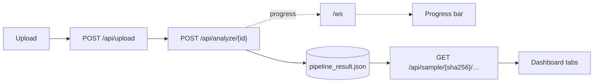

# DroidForensix — What We Do and How We Do It

> **Scope.** A one-document overview for new contributors, reviewers, and
> investigators: what the project is, how an APK moves through it, how we
> decide what is true, and where the encrypted-APK case study fits.
> It summarises; the deeper references are linked in [§9](#9-where-to-read-next).

---

## Contents

1. [What we do](#1-what-we-do)
2. [The two-stage design](#2-the-two-stage-design)
3. [How a sample flows through the system](#3-how-a-sample-flows-through-the-system)
4. [The analysis pipeline (18 steps)](#4-the-analysis-pipeline-18-steps)
5. [The unpacking lane (encrypted and packed APKs)](#5-the-unpacking-lane-encrypted-and-packed-apks)
6. [Family attribution](#6-family-attribution)
7. [Backend and dashboard](#7-backend-and-dashboard)
8. [How we decide what is true](#8-how-we-decide-what-is-true)
9. [Where to read next](#9-where-to-read-next)

---

## 1. What we do

DroidForensix analyses Android APK files for digital-forensics and malware
triage. For one APK it produces:

- the package's identity, certificate, permissions and components;
- the strings, encodings and decoded payloads found inside it;
- candidate command-and-control (C2) endpoints and other indicators (IOCs);
- a best-effort **malware family** attribution;
- for packed or encrypted samples, a route to recover the hidden payload.

It is built for a forensic workflow: every result is traceable to a file and a
step, and the system prefers saying "unknown" or "failed" to guessing.

## 2. The two-stage design

The system is split so that the **analysis is the source of truth** and
everything else only reads its output.

| Stage | Location | Responsibility |
|---|---|---|
| **1. Offline analysis** | `analysis/` | Runs the 18-step pipeline on one APK. Writes one artifact: `<work_dir>/<sha256>/pipeline_result.json`. |
| **2. Viewer** | `backend/` (FastAPI), `frontend/` (React + Vite) | Reads `pipeline_result.json` and serves it over REST and a `/ws` WebSocket for progress. |

Rules that follow from the split:

- **Detection logic belongs in `analysis/`.** Putting it in `backend/` breaks
  the "viewer only" boundary. The one documented exception is
  `backend/family_id.py`, which does attribution.
- The backend never re-runs detection to answer a dashboard request.
- Ground truth and evaluation tooling live beside the product but are not
  part of the product path.

## 3. How a sample flows through the system

The `sample_id` is the APK's SHA-256, so re-analysing the same file is
idempotent and every artifact is addressable by hash.

## 4. The analysis pipeline (18 steps)

`analysis/pipeline.py:run_pipeline` runs the steps in order. Each step has a
timeout, and checks its predecessor's output before running
(`_validate_step_input`). A step that fails is recorded with its reason; the
pipeline continues where the data allows.

| # | Step | What it establishes |
|---|---|---|
| 1 | APK extraction | Unpacks the archive; manifest, DEX, native libs, assets, hashes |
| 2 | String enumeration | Every string constant across DEX and resources |
| 3 | Encoding detection | Base64, hex, XOR and similar encodings in those strings |
| 4 | Payload decoding | Decodes detected encodings into candidate payloads |
| 5 | C2 extraction | Candidate hosts, IPs, URLs and domains |
| 6 | Threat-chain correlation | Links sources, decoders and endpoints into chains |
| 7 | Obfuscation analysis | Reflection, renaming and control-flow signals |
| 8 | LLM assessment | Language-model reading of the evidence (advisory; see [§8](#8-how-we-decide-what-is-true)) |
| 9 | Family identification | Attribution via `backend/family_id.py` |
| 10 | Binary packing detection | Entropy and DEX-structure heuristics, plus `data/packer_markers.json` |
| 11 | String entropy & clustering | High-entropy strings grouped (often keys or encrypted blobs) |
| 12 | Reflective method tracing | Calls resolved at runtime by name |
| 13 | Native ELF analysis | Native library imports, exports and suspicious behaviour |
| 14 | Network protocol analysis | Protocol shape of the network code |
| 15 | Reflective-permission correlation | Dangerous permissions used via reflection |
| 16 | Certificate analysis | Signing certificate, issuer and test-key checks |
| 17 | Family clustering | Groups the sample with similar samples |
| 18 | Threat synthesis | Final threat profile from all of the above |

*Edges show data dependencies, not strict run order; the orchestrator runs the
numbered order and validates each step's inputs.*

Notes:

- `analysis/step0_master_key.py` and `analysis/payload_evidence.py` are wired in
  before classification when available. They carry recovered keys and payloads
  into the evidence set.
- Modules `step19_container_repair`, `step20_payload_kdf_crack` and
  `step21_string_deobfuscation` exist in `analysis/` but are **not** in the
  18-step orchestrator's `STEP_NAMES`. Treat them as standalone tools until
  they are wired in.
- Run one step, or the whole pipeline, headless:
  `python analysis/step1_apk_extraction.py <apk> [work_dir]` and
  `python -m analysis.pipeline <apk>`.

## 5. The unpacking lane (encrypted and packed APKs)

Some samples hide the real payload. Step 10 flags them; the unpacking lane tries
to recover the payload **without running the sample on a device**.

Key components:

| Component | Role |
|---|---|
| `scripts/triage.py`, `data/packer_markers.json` | Packer triage (six heuristics) |
| `scripts/unpack.py` | Dispatcher: routes native vs Java, runs validators, emits E-codes |
| `scripts/emulate.py` | Unicorn/LIEF JNI emulation oracle (ARM64, ARM32-Thumb, x86_64) |
| `scripts/rto_oracle.py`, `scripts/rto_deep_run.py` *(deleted 2026-11-12, see git history)* | RTO-specific oracle and checkpointed continuation |
| `scripts/ijiami_oracle.py` | Same idea applied to a second packer (generalisation check) |
| `stage3_replay.py` | Byte-exact Python port of a seeded PRNG string table |
| `rto_analysis/unpacking_tool.py` | Standalone CLI wrapping the lane; always ends in `RECOVERED` or a typed E-code |

The **full worked example** — how the RTO banker was broken step by step,
which file produced which piece of evidence, how the result was verified, and
what we did *not* claim — is in:

> **[RTO Encrypted APK Breakdown — Case Study](RTO_encrypted_apk_breakdown_CASE_STUDY.md)**
> (also summarised in [`HOW_IT_WORKS.md` §7–8](HOW_IT_WORKS.md#7-how-we-attack-an-encrypted-apk)).

Headline of that case: `RTO.apk` keeps its payload in `assets/myg0N`, encrypted
with a key assembled at runtime by native code. We recovered the key by observing
the assembly in an emulator, decrypted the 10-entry dropper kit, and confirmed it
with a ZIP validity gate and a pre-recorded IOC hash. No device was used.

## 6. Family attribution

Attribution is three layers, applied in order (`backend/family_id.py`):

The LLM backend (Ollama, NVIDIA NIM or OpenRouter, chosen in `.env`) is used in
step 8 and in layer 3. Its output is a **choice among signals that actually
matched**, not free-form naming.

## 7. Backend and dashboard

- **Backend** (`backend/`): FastAPI app. `load_result` turns
  `pipeline_result.json` into view models; `dissection.py` builds per-tab detail
  lazily and caches it; `routers/` holds the REST surface (`samples`, `analyst`,
  `intel`, `jobs`, `reports`, `threat_intel`).
- **Frontend** (`frontend/`): React + Vite dashboard. Upload, live progress over
  `/ws`, the sample page (`SampleDetail`) with dissection tabs, attribution
  evidence, C2 and threat-intel panels, and PDF reports.
- Start locally: `python -m backend.main` (API on :8000) and
  `cd frontend && npm run dev` (UI on :5173).

## 8. How we decide what is true

These rules shape both the code and how results are written up.

1. **The bytes decide.** A recovered payload must pass a structural check
   (ZIP central directory, DEX magic, padding) and, where available, match a
   pre-recorded hash. A wrong key produces garbage, and garbage is reported as a
   failure, not as a result.
2. **Measure, don't assert.** Accuracy claims come from the corrected ground
   truth (`ground_truth_all_corrected.csv`), not from the headline counts.
3. **Advisory is labelled advisory.** LLM output and family labels are
   presented as assistance for an analyst, with their evidence attached.
4. **No silent failures.** Each step has a typed status; an unknown result is
   shown as unknown.
5. **Evidence stays local.** Keys, recovered payloads and case artefacts are
   kept out of git; only tools and write-ups are tracked.

Honest numbers (from the README, which should be quoted rather than the top-line
counts):

| Measure | Result |
|---|---|
| Family-ID exact match (352 corrected GT) | **64.2%** (226/352); 68.6% on specific families |
| Indicators confirmed as genuine C2 | **2.4%** of raw extracted indicators |
| Indicators clearly benign | 68% |

Family identification is advisory. Opaque-obfuscation families and
toolkit-shared families remain hard.

## 9. Where to read next

| Topic | Document |
|---|---|
| RTO encrypted-APK case study (file-by-file walkthrough) | [`RTO_encrypted_apk_breakdown_CASE_STUDY.md`](RTO_encrypted_apk_breakdown_CASE_STUDY.md) |
| Full how-it-works with the unpacking method | [`HOW_IT_WORKS.md`](HOW_IT_WORKS.md) |
| Code layout and layers | [`ARCHITECTURE.md`](ARCHITECTURE.md) |
| Packer handling | [`PACKERS.md`](PACKERS.md), [`PACKER_FRAMEWORK.md`](PACKER_FRAMEWORK.md), [`PACKER_SOP.md`](PACKER_SOP.md) |
| Master-key strategy | [`MASTER_KEY_STRATEGY.md`](MASTER_KEY_STRATEGY.md) |
| API | [`API.md`](API.md) |
| Setup, usage, performance | [`SETUP.md`](SETUP.md), [`USAGE.md`](USAGE.md), [`PERFORMANCE.md`](PERFORMANCE.md) |
| Standalone unpacking tool | [`../rto_analysis/README.md`](../rto_analysis/README.md) |
