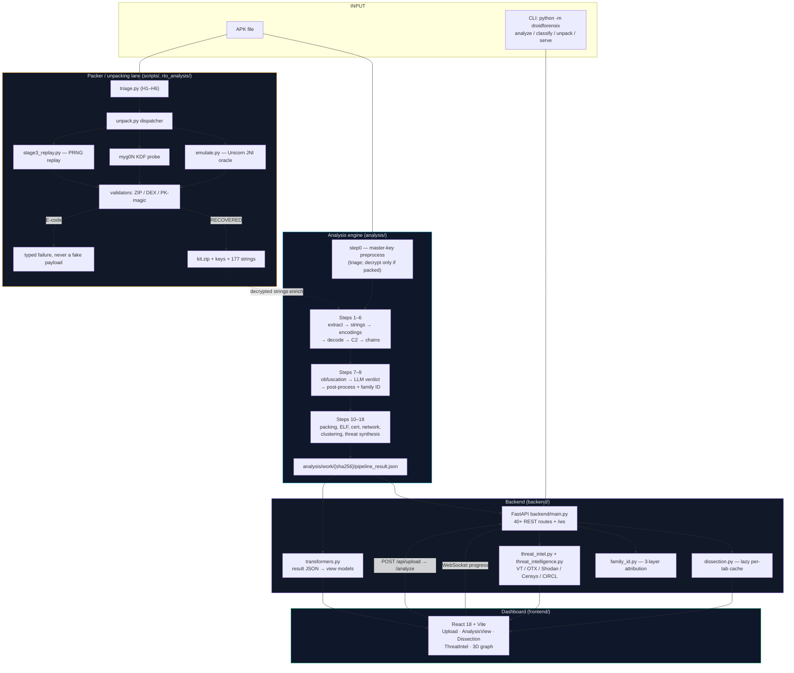
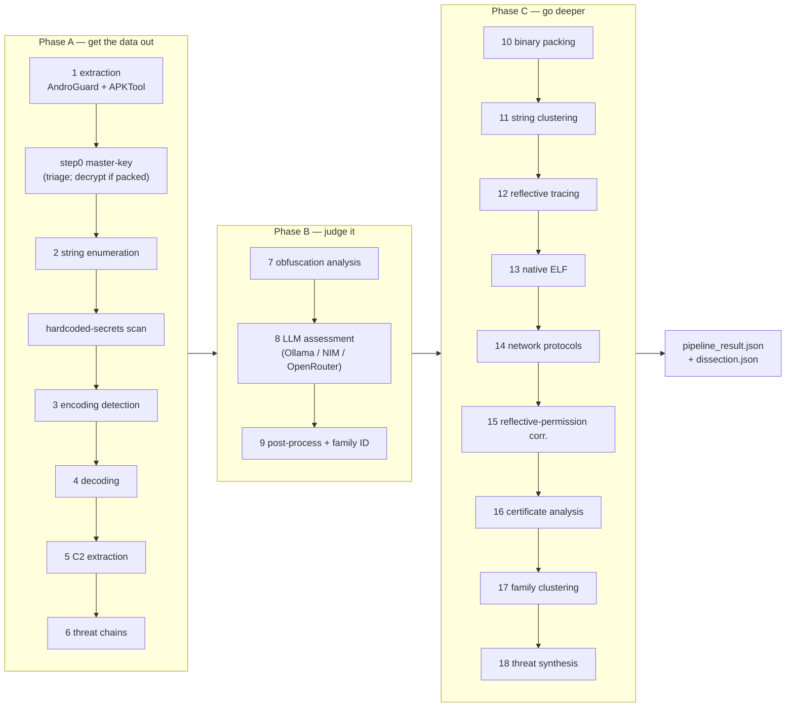
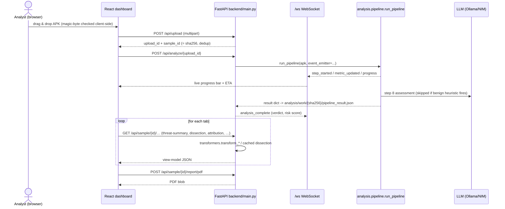
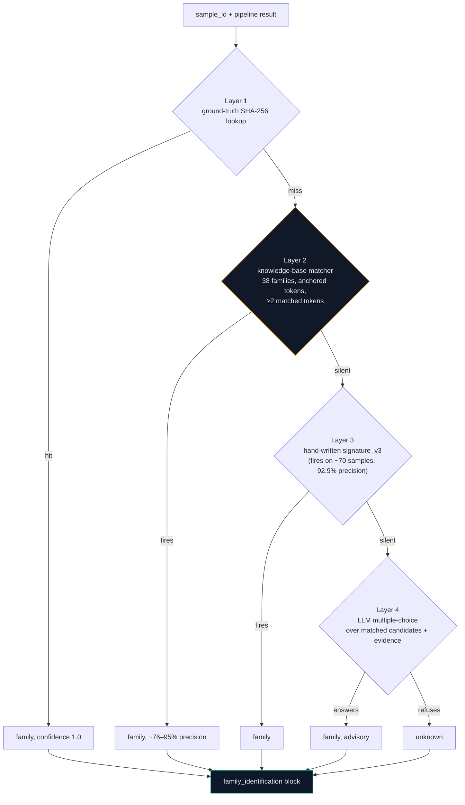
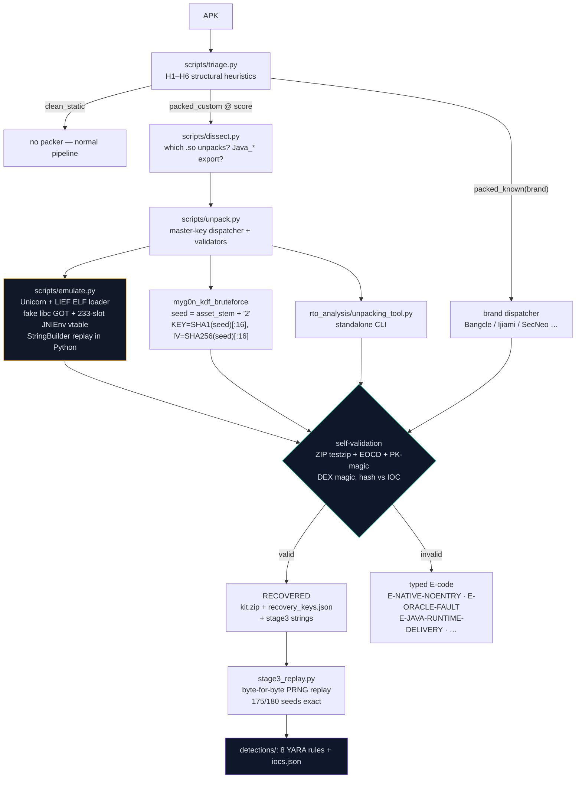
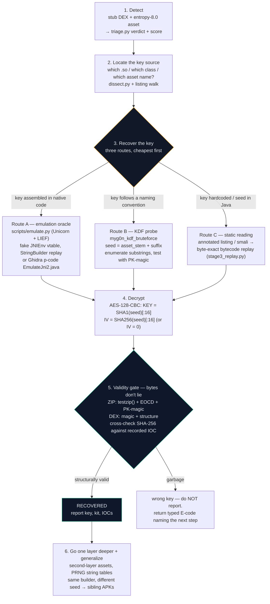
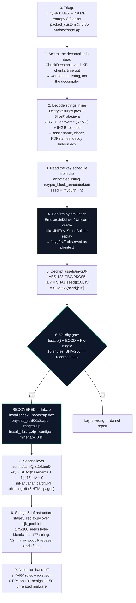

# DroidForensix — How The Whole Project Works — **INTERNAL / FULL DETAIL**

> ⚠️ **Internal document.** This is the unabridged engineering version: exact
> file paths, commands, parameters, acceptance bars, and key derivations. The
> shareable explanatory version is `docs/HOW_IT_WORKS.md`.
>
> Do not hand this file out with review copies — share
> `docs/HOW_IT_WORKS.md` (or its PDF) instead.

> **Purpose.** One document that explains the entire system end-to-end: what it
> is, how an APK travels through it, how packed/encrypted samples get broken
> open, and where each subsystem lives.
>
> **Relationship to other docs.** This is the *map*. Detail lives elsewhere:
> [`ARCHITECTURE.md`](ARCHITECTURE.md) (module map), [`codebase-reference.md`](codebase-reference.md)
> (file-by-file), [`API.md`](API.md) (endpoints), [`PACKERS.md`](PACKERS.md) (packer matrix),
> and — for the flagship reverse-engineering case —
> [`RTO_encrypted_apk_breakdown.md`](RTO_encrypted_apk_breakdown.md) (§8 below is
> the condensed version of that 670-line evidence walkthrough).
>
> **Verified against the code on 2026-10-06** (`analysis/pipeline.py`,
> `backend/main.py`, `rto_analysis/unpacking_tool.py`).

---

## Table of contents

1. [The one-paragraph version](#1-the-one-paragraph-version)
2. [System map](#2-system-map)
3. [The 18-step analysis pipeline](#3-the-18-step-analysis-pipeline)
4. [Backend + dashboard request lifecycle](#4-backend--dashboard-request-lifecycle)
5. [Family attribution](#5-family-attribution)
6. [The packer / unpacking lane](#6-the-packer--unpacking-lane)
7. [How we attack an encrypted APK](#7-how-we-attack-an-encrypted-apk-the-general-method)
8. [Case study: how `RTO.apk` was broken](#8-case-study-how-rtoapk-was-broken)
9. [Where results go (reports & exports)](#9-where-results-go-reports--exports)
10. [Evaluation: the honest numbers](#10-evaluation-the-honest-numbers)
11. [Running & testing the project](#11-running--testing-the-project)
12. [Known boundaries](#12-known-boundaries)

---

## 1. The one-paragraph version

DroidForensix is an **Android malware static-analysis system**: it takes an APK,
never executes it, and produces a structured threat report. AndroGuard and
APKTool decompose it → an 18-step pipeline extracts strings, decodes obfuscated
payloads, pulls out C2 infrastructure, scores obfuscation, and asks an LLM for a
verdict → a FastAPI backend turns that JSON into REST + WebSocket views → a
React dashboard renders it. Alongside the routine pipeline there is a second,
deeper lane: a **packing/unpacking subsystem** that statically recovers
encrypted payloads — the general method is §7, the worked `RTO.apk` case is
§8. Everything is reproducible from committed code; only recovered evidence and
key material is deliberately local-only.

---

## 2. System map



**The load-bearing invariant:** the backend and dashboard are *viewers*. All
detection logic lives in `analysis/` (routine lane) and `scripts/` +
`rto_analysis/` (unpacking lane). The API adds attribution/threat aggregation
but does not re-decide anything about the sample.

### Directory map

| Directory | Role |
|---|---|
| `analysis/` | 18-step pipeline, ML classifiers, family knowledge mining, campaign clustering |
| `backend/` | FastAPI service: routes, orchestration, attribution, dissection, threat intel, PDF/STIX/YARA |
| `frontend/` | React/Vite dashboard over the REST + WS API |
| `scripts/` | Research tooling: `triage`/`unpack`/`dissect`/`emulate`/oracles, dataset & ground-truth builders |
| `rto_analysis/` | The RTO unpacking case study + standalone `unpacking_tool.py` (mostly gitignored evidence) |
| `droidforensix/` | CLI package: `python -m droidforensix <analyze\|classify\|serve\|unpack>` |
| `data/` | GeoLite2, `packer_markers.json`, allowlists, known-bad certificates |
| `evaluation/`, `evaluation_results/` | Validation harness + committed metric outputs |
| `tests/`, `frontend/__tests__/` | pytest suite + Vitest suite |
| `docs/` | This doc and its siblings |
| `thesis/` | Thesis chapters incl. `06_unpacking_case_study.md` |

---

## 3. The 18-step analysis pipeline

Entry point: `analysis/pipeline.py` → `run_pipeline(apk_path, work_dir=None, …)`.
Default work dir is `analysis/work`; every run writes
`analysis/work/<sha256>/pipeline_result.json`, the single artifact everything
downstream reads. Each step has its own timeout (default 300 s), validates its
predecessor's output, and emits `step_started` / `step_completed` /
`metric_updated` events over the WebSocket. `TOTAL_STEPS = 18`.



| Run step | Module | What it produces |
|---|---|---|
| 0 *(pre)* | `step0_master_key.py` | Master-key/KDF attempt on packed samples; on `RECOVERED` its decrypted-kit strings **enrich step 2** so downstream C2/family see plaintext; on E-code the sample is marked catch-all |
| 1 | `step1_apk_extraction.py` | APKTool unpack + AndroGuard manifest/permissions/components/DEX metadata, native strings, hashes |
| 2 | `step2_string_enumeration.py` | Dalvik bytecode strings (smali fallback), Shannon entropy, framework-noise filtering |
| — | `hardcoded_secrets.py` (inline) | API keys, JWTs, Firebase URLs, private keys, Telegram tokens |
| 3 | `step3_encoding_detection.py` | Base64 / URL-safe / hex / XOR detection with 5-rule FP filter + confidence score |
| 4 | `step4_decoding.py` | Decodes payloads, extracts URLs/IPs/domains/emails/phones, magic-byte binary typing |
| 5 | `step5_c2_extraction.py` (+ allowlists, tiers) | Structured C2 records, ~500-entry benign-domain allowlist, confidence scoring, optional CIRCL enrichment |
| 6 | `step6_correlation.py` | Directed threat chains encoding → decode → artifact → C2, weighted composite confidence |
| 7 | `step8_obfuscation_analysis.py` | Reflection/dynamic-loading/packing/encrypted-asset signals, 0–100 obfuscation score |
| 8 | `step7_llm_assessment.py` | LLM verdict + narrative; sanity-checked and rule-backed if the LLM is absent |
| 9 | `step9_post_process.py` → `backend/family_id.py` | Sanity corrections, then family attribution |
| 10 | `step10_binary_packing.py` | Structural packing detection + `data/packer_markers.json` brand markers → `packer_brands` |
| 11–16 | `step11…step16` | String clustering, reflective call tracing, native ELF analysis, network protocol analysis, reflective-permission correlation, signing-certificate analysis |
| 17 | `step17_family_clustering.py` | Cross-sample family clustering |
| 18 | `step18_threat_synthesis.py` | Final multi-signal threat-intel synthesis |

> ⚠️ **Two naming gotchas (verified in code):**
> 1. Run step **7 is obfuscation** (`step8_obfuscation_analysis.py`) and run step
>    **8 is the LLM** (`step7_llm_assessment.py`) — the module filenames are
>    swapped relative to execution order.
> 2. `step19_container_repair.py`, `step20_payload_kdf_crack.py` and
>    `step21_string_deobfuscation.py` exist as **standalone modules**
>    (`python -m analysis.step19_container_repair <apk> …`) and are *not* wired
>    into `run_pipeline`. Older docs describing a "9-step pipeline" reflect an
>    earlier revision.

Every step is individually runnable: `python analysis/step1_apk_extraction.py <apk> [work_dir]`, then `step2`, …

**Degradation paths:** giant APKs can skip steps 2–3 (`skip_steps`), the LLM
layer is skipped for benign-looking samples (~40% of the corpus, ~2× speedup),
and every LLM/family/obfuscation step is wrapped in a fallback so one failure
degrades that field instead of killing the run.

---

## 4. Backend + dashboard request lifecycle



Key behaviours:

- **`POST /api/upload`** dedupes on SHA-256 and returns `upload_id` + `sample_id`.
- **`POST /api/analyze/{upload_id}`** runs `run_pipeline` and pushes progress
  over `/ws` (`ConnectionManager` broadcast, thread-safe via
  `asyncio.run_coroutine_threadsafe`).
- **Read path** is pure view shaping: `backend/transformers.py`
  (`load_result`, `transform_graph`, `transform_clusters`, `transform_timeline`,
  `transform_samples_list`) turns `pipeline_result.json` into the payloads the
  dashboard wants — 3D graph nodes with deterministic MD5 IDs, cluster scatter,
  attack-chain timeline.
- **Dissection** (`backend/dissection.py`) is lazy: manifest/permissions/
  components/DEX/classes/strings tabs are computed on first request and cached
  with a TTL, so opening a sample never pays the full AndroGuard cost twice.
- Frontend resilience: exponential-backoff upload retry
  (`min(2000·2^(n-1), 32000) + jitter`), 20 s WS keepalive, 2 s health polling
  when the backend is down.

---

## 5. Family attribution

The 64.2% headline accuracy comes from three voting layers (plus a
ground-truth shortcut) in `backend/family_id.py`:



- Deterministic layers are preferred over the LLM (the LLM is only consulted
  when deterministic confidence < 0.75, and sees *candidate families + actually
  matched signals* — this fixed an earlier 63.8% refusal rate).
- E-coded samples (commercial packer expected, see §6–§8) are **forced to
  `unknown` with the E-code as reason**, so accuracy metrics count them as
  catch-all rather than as wrong family guesses.
- Knowledge base is mined from corrected ground truth:
  `python analysis/mine_family_knowledge.py` → `analysis/family_knowledge_base.json`.
- Ground truth: `ground_truth_all_corrected.csv` (359 malware + 100 benign,
  re-verified on VirusTotal/MalwareBazaar).

---

## 6. The packer / unpacking lane

Most of the project answers "what does this APK do?". This lane answers a
harder question: **"what is this APK hiding behind encryption, and can we get it
out without ever running it?"**

The one-line idea (from [`MASTER_KEY_STRATEGY.md`](MASTER_KEY_STRATEGY.md)):

> Don't run the malware. Make it run itself inside a fake world, then write
> down every secret it touches.



**The three recovery techniques** (the "hybrid static blueprint"):

| # | Technique | Tool | What it buys |
|---|---|---|---|
| 1 | **Listing-level symbolic evaluation** | `rto_analysis/ghidra_scripts/DecryptStrings.java` + `SliceProbe.java` | Walks raw ARM64 listings for `adrp/add → mov #imm → ldrb → eor → strb` chains and recovers XOR'd string tables byte-by-byte — works where the decompiler OOMs |
| 2 | **JNI emulation oracle** | `scripts/emulate.py`, `scripts/rto_oracle.py`, Ghidra `EmulateJni2.java` | Runs the packer's own native decoder on a toy CPU with a mocked `JNIEnv*`; every JNI call is logged and `StringBuilder` assembly is replayed, so the key appears as plaintext |
| 3 | **Bytecode replay** | `stage3_replay.py` + `cjk_pool.txt` | Ports the installer's 64-bit mul-xorshift PRNG straight from smali to Python — regenerates 177 strings with no execution at all |

**Contract that matters:** a run always ends in `RECOVERED` (artifacts that
passed the validity gate) or a typed `E-code` naming the exact failure. The tool
never fabricates a payload. Exit codes: `0` recovered/no packer, `1` E-code, `2`
usage error.

Supporting docs: [`PACKERS.md`](PACKERS.md) (brand matrix + E-code taxonomy),
[`MASTER_KEY_STRATEGY.md`](MASTER_KEY_STRATEGY.md) (the 7-step playbook),
[`FULL_KNOWLEDGE_TRANSFER.md`](FULL_KNOWLEDGE_TRANSFER.md) (why blind shots fail).

---

## 7. How we attack an encrypted APK (the general method)

> This is the repeatable playbook, independent of any one sample. §8 is the
> worked example (`RTO.apk`); this section is what you'd do to the *next*
> encrypted APK. Companion docs: [`MASTER_KEY_STRATEGY.md`](MASTER_KEY_STRATEGY.md)
> (plain-words checklist) and [`FULL_KNOWLEDGE_TRANSFER.md`](FULL_KNOWLEDGE_TRANSFER.md)
> (when to stop fighting a dead end).

### 7.1 Recognising "encrypted" rather than merely "packed"

You are probably facing an encrypted payload when **all** of these hold:

| Smell | Where you see it |
|---|---|
| Stub `classes.dex` — tiny, no C2, no package names, only `System.loadLibrary` + one native call | `7z l sample.apk`, `analysis/step2` string enumeration returns nothing useful |
| One oversized asset with a random-looking name, entropy ≈ 8.0 (ciphertext, not an image/audio) | `scripts/triage.py` H2 → `packed_custom @ score` |
| Standard IOC extraction finds nothing | step 5 returns no C2 — the *defining* smell of a packed sample |
| All logic lives in one native `.so` | `scripts/dissect.py` → which `.so`, is there a `Java_*` export to start from |

Entropy + structure alone tell you it is *packed*. They do **not** tell you the
crypto — that needs the next step.

### 7.2 The core insight: the key is never on disk

> **The combination is not written anywhere.** The sample *assembles* it at
> runtime — often inside deliberately scrambled native code that decompilers
> cannot process (RTO's `SUO4` = 36,000 flattened instructions; Ghidra's
> decompiler OOMs on 1 KB chunks).

Two consequences that shape the whole method:

1. **Blind key search is the wrong first instinct.** (An early 98-seed ×
   3-KDF × 857k-suffix sweep failed — not because the key was wrong, but
   because the *validation* method was wrong; emulation removed the artifact.
   See §8.2 step 4 and RTO doc §4.1.)
2. **We never break the lock — we watch the thief unlock it.** The sample
   carries its own key and does its own crypto; we let *it* perform the
   decryption inside an environment we fully control (a toy CPU with fake Java
   APIs) and record every secret it touches. **Nothing ever runs on a phone.**

### 7.3 The six-stage method



### 7.4 Where keys actually come from (the four sources)

| Key source | How we read it | Verified example |
|---|---|---|
| **Assembled at runtime** in native code (string fragments concatenated, then hashed) | JNI emulation oracle — every `StringBuilder.append` is replayed and logged, so the seed appears as plaintext | RTO outer container: `"myg0N" + "2"` → `"myg0N2"` |
| **Derived from the asset/file name** (a naming convention, no string in the binary) | KDF probe: enumerate substring seeds from the asset stem, derive, and test against the container's PK-magic | `seed = asset_stem + "2"`, `KEY = SHA1(seed)[:16]`, `IV = SHA256(seed)[:16]` |
| **Hardcoded in Java/smali** (a `decryptStream` helper) | Read the smali, port the derivation by hand, verify independently | payload assets: `SHA1(basename + "1")[:16]`, **IV = 0** |
| **A PRNG seed feeding a string table** | Byte-for-byte bytecode replay in Python — no runtime at all | stage-3 installer: 64-bit mul-xorshift over a 4,320-char CJK pool → 177 strings, 175/180 byte-identical |

The recurring shape across every recovered sample:

```
seed  →  KEY = SHA1(seed)[:16]   /   IV = SHA256(seed)[:16]  (or IV = 0)
```

Only the *seed* differs per builder — which is exactly why breaking one APK
usually breaks its siblings (§8.4).

### 7.5 Rules we don't bend

1. **Decryption proves nothing on its own.** A wrong AES key also produces
   bytes. Only structural validity (ZIP central directory, DEX magic, EOCD,
   PKCS#7 pad) plus an **independent hash recorded before the analysis** turns
   bytes into evidence.
2. **Use a negative control.** Apply the *wrong* sibling derivation and show it
   fails — that's what rules out a lucky match on the two-layer split.
3. **Never fabricate a recovery.** If the oracle faults, return a typed E-code
   (`E-ORACLE-FAULT`, `E-NATIVE-NOENTRY`, `E-JAVA-RUNTIME-DELIVERY`, …) that
   names the failure and the next step. Exit code `1`, not a garbage payload.
4. **Read-only on the exhibit.** The APK is never modified; hashes are the
   chain-of-custody anchor.
5. **Key material ships in local-only files.** Public write-ups carry the
   *derivation* (re-derivable in one line); the hex lives in
   `detections/iocs.json` §`crypto` and the vault's `ARTIFACTS_SENSITIVE.md`.
6. **Runtime-delivered stages stay undelivered.** If the payload is fetched
   from live C2 (miner ELF, pool config), we document the delivery path and the
   decryption scheme — we do not touch live infrastructure.

### 7.6 Where it plugs into routine analysis

`analysis/step0_master_key.py` runs this method automatically inside every
pipeline run: triage → attempt decrypt → on `RECOVERED`, merge the kit's
plaintext strings into step 2 (so C2 extraction and family ID see real text) →
on an E-code, tag the sample `is_e_coded` so family ID answers `unknown` with a
reason instead of guessing. The offline lane (`scripts/`, `rto_analysis/`) is
where you run it manually, deeper, with full traces.

---

## 8. Case study: how `RTO.apk` was broken

> **Full evidence walkthrough:** [`RTO_encrypted_apk_breakdown.md`](RTO_encrypted_apk_breakdown.md)
> — file-by-file evidence map, LEA + expert narratives, reproducibility recipes,
> verification controls V1–V8, and the honest boundaries. This section is the
> orientation guide; that document is the record.

### 8.1 The target

| Property | Value |
|---|---|
| Sample | `RTO.apk` (repo root) — 8,397,289 B, live 2026 sample |
| SHA-256 | `348f8b090b51ba27e9042f19730a61c04bb31691d7939fd1047dffc5f51a8d4e` |
| Cluster | BeatBanker / BTMOB (fake Indian e-challan phishing + XMR miner + silent install) |
| Stub | `classes.dex` → `System.loadLibrary("strangulation")` → native `jD3P.SUO4()` |
| Native | `libstrangulation.so` — one flattened function `SUO4` @ `0x110058`, ~36,000 instructions |
| Encrypted blob | `assets/myg0N` (7,714,912 B, entropy 8.0 = ciphertext) |

Two dead ends forced the approach:

1. **Decompiler dead end** — Ghidra's decompiler OOMs/times out even on 1 KB
   chunks of `SUO4`; the cause is structure (8,170 `eor` + 8,201 `ldrb` +
   8,207 `strb` in flattened straight-line blocks), not size.
2. **Dynamic dead end** — the sample fingerprints the environment
   (`Build.CPU_ABI`, `MANUFACTURER` vs `unknown/generic/google`) and gates the
   real loader behind `SharedPreferences.getBoolean("v") == true`, so a naive
   emulator run only ever executes a decoy accelerometer app.

### 8.2 The break



### 8.3 The recovered key derivation

```
seed = "myg0Nbootstrap.dex".substring(0,5) + "2"   →  "myg0N2"
KEY  = SHA1(seed)[:16]
IV   = SHA256(seed)[:16]
Cipher = AES/CBC/PKCS5Padding
         assets/myg0N  →  10-entry ZIP dropper kit
```

*(Exact KEY/IV hex is deliberately not printed here — evidence-handling rule:
key material only ships in local-only files, `detections/iocs.json` §`crypto`
and the vault's `ARTIFACTS_SENSITIVE.md`. Re-derive in one line:)*

```bash
python -c "import hashlib;print(hashlib.sha1(b'myg0N2').hexdigest()[:32]);print(hashlib.sha256(b'myg0N2').hexdigest()[:32])"
```

**Two independent recovery routes agree** — Ghidra p-code emulation (ground
truth, Phase 4) and the shipped Unicorn/LIEF oracle with the
`myg0n_kdf_bruteforce()` probe (reference run: `RECOVERED` in 1.31 s).

### 8.4 The two-layer key split

| Scheme | Key | Verifies with |
|---|---|---|
| Outer container (`myg0N`) | `SHA1(asset_stem + "2")[:16]`, `IV = SHA256(...)` | the dropper kit ZIP |
| Payload asset (`proj.App.decryptStream`) | `SHA1(asset_basename + "1")[:16]`, **IV = 0** | `data*` assets → phishing kit |
| Downloaded files (`SecureAssets.decryptFile`) | `SHA1(file_basename)[:16]`, **IV = 0** | runtime-fetched files (e.g. miner ELF) |

A **negative control** — the installer scheme (no `+1`) applied to the payload
asset — fails PKCS#7 pad verification, which is what proves the split is real
rather than a lucky match.

### 8.5 Why a decrypted file alone is not proof

Every claim rests on an independent check (full table in the RTO doc §3B):

| # | Check | Proves |
|---|---|---|
| V1 | `testzip()` + EOCD + PK-magic on the container, 10 entries | a wrong key cannot yield a valid ZIP central directory |
| V2 | Decrypted kit SHA-256 == IOC recorded in Phase 4 *before* the tool existed | the tool reproduces the original artifact byte-for-byte |
| V3 | Independent re-decryption of layer 2, hash matches IOC | the `+1` key split is correct |
| V4 | Negative control (wrong sibling scheme) **fails** | V3 isn't a coincidence |
| V5 | PRNG replay: 175/180 seeds byte-identical, 5 residuals documented seed-by-seed | 177 strings were *regenerated*, not transcribed |
| V6 | 6 external packed samples → correct verdicts or correct E-codes | no selection bias, no hallucinated recoveries |
| V7 | 8 YARA rules → 0 FPs on 101 benign + 150 unrelated malware | detections generalize |
| V8 | Same KDF unlocked 5 more seized APKs (seed `UZrF0u2`, `ZoCv0N2`, `LAZx0b2`, …) | the break is a property of the *builder*, not a lucky seed |

### 8.6 Reproducing it

```bash
# Path A — fast (≈1–2 min), the shipped tool
pip install -r requirements-lock.txt
python rto_analysis/unpacking_tool.py --input RTO.apk --output recovered/ --stage3 --bundle --timeout 480
pytest tests/test_unpacking_tool.py tests/test_stage3_replay.py -q
# expect: verdict RECOVERED, stage3 matches == 175, mismatches == 5
```

Path B (faithful, slow) re-runs the original Ghidra p-code emulator — see §6 of
the RTO doc. Both are read-only on the APK.

### 8.7 How the case feeds the main pipeline

The unpacking lane is not a side project — `analysis/step0_master_key.py` wires
it into every routine run:

1. Step 0 triages packing and attempts the myg0N KDF/oracle decrypt.
2. On `RECOVERED`, `enrich_strings_with_recovered()` merges the decrypted-kit
   plaintext into step 2's string set — this is what rescues otherwise-opaque
   families (Opfake/FakeInstaller-style) in C2 extraction and family ID.
3. On an E-code, the sample is tagged `is_e_coded` so family ID returns
   `unknown` with a reason, and accuracy metrics count it as catch-all rather
   than a model miss.

---

## 9. Where results go (reports & exports)

| Output | Producer | Contents |
|---|---|---|
| `analysis/work/<sha256>/pipeline_result.json` | `analysis/pipeline.py` | the whole report — metadata, extraction, strings, encodings, C2, chains, obfuscation, LLM, family, steps 10–18, timeline |
| `analysis/work/<sha256>/dissection.json` | `backend/dissection.py` | structural tabs (manifest, permissions, components, DEX, classes, strings) |
| PDF | `backend/pdf_report.py`, `pdf_report_enhanced.py` | cover, LLM assessment, C2 table, TI enrichment, 3-layer risk methodology |
| STIX 2.0 / CSV / YARA | `backend/threat_intel.py` | export formats for the threat-intel view |
| IOC bundle + YARA | `rto_analysis/detections/` | `iocs.json` (hashes, network IOCs, Firebase configs, **crypto derivations incl. key/IV hex**), `beatbanker_rto.yar` (8 rules) |
| 3D graph / clusters / timeline | `backend/transformers.py` | dashboard view models |

**Git vs. evidence rule:** toolchain, tests, and write-ups are tracked;
recovered payloads, keys, traces and deep-dive phase reports are **local-only**
(gitignored) and handed over as evidence separately. See §8 of the RTO doc for
the exact table.

---

## 10. Evaluation: the honest numbers

Committed and reproducible (`README.md` → Evaluation, `evaluation_results/`):

| Metric | Value | Caveat |
|---|---|---|
| C2 indicators extracted | 1,711 from 277 samples, 12 countries | **extraction** count, not verified accuracy |
| Indicator precision (manual review, 380 indicators) | **2.4% confirmed malicious, 68% clearly benign** | heuristics favor recall by design |
| Family ID exact-match (352-sample corrected GT) | **64.2%** (68.6% on specific families) | treat as advisory |
| Recall on balanced set | 95% | after the string-entropy filter fix |
| Speedup vs. manual | 63× (204 timed samples) | LLM path ~1.5 min; heuristic-skip ~0.4 min |

Reproduce:

```bash
python analysis/mine_family_knowledge.py
python evaluation/reeval_families.py --output-dir evaluation/metrics_v2   # needs Ollama
python evaluation/metrics_recompute.py --gt ground_truth_all_corrected.csv \
    --predictions evaluation/metrics_v2/predictions.json --output-dir evaluation/metrics_v2
```

---

## 11. Running & testing the project

```bash
pip install -r requirements-lock.txt
cp .env.example .env

# Terminal 1 — LLM backend (optional but recommended)
ollama serve                      # or run_ollama.bat on Windows

# Terminal 2 — API
python -m backend.main            # http://localhost:8000     (run_backend.bat)

# Terminal 3 — dashboard
cd frontend && npm install && npm run dev    # http://localhost:5173 (run_frontend.bat)
```

Headless / CLI:

```bash
python -m analysis.pipeline samples/malware/example.apk   # → analysis/work/<sha256>/pipeline_result.json
python -m droidforensix analyze <apk>                     # CLI package
python scripts/triage.py <apk>                            # packer triage (H1–H6)
```

Tests:

```bash
pytest tests/ -q             # backend
cd frontend && npm test      # Vitest (247 tests / 38 files)
```

More: [`USAGE.md`](USAGE.md) (setup + troubleshooting), [`API.md`](API.md),
[`dashboard-guide.md`](dashboard-guide.md), [`PERFORMANCE.md`](PERFORMANCE.md).

---

## 12. Known boundaries

Stated up front so nobody over-reads the output:

- **Static only.** No execution, no emulator, no dynamic confirmation — so
  C2-blind malware (zero static artifacts) is a documented blind spot.
- **Indicator extraction is high-recall / low-precision** (2.4% confirmed
  malicious in manual review). Most FPs are Google/Firebase/CDN infrastructure.
- **Family ID is advisory** at 64.2%; opaque-obfuscation and toolkit-shared
  families remain hard.
- **The unpacking oracle is JNI-layer by design** — Java-only unpackers return a
  typed `E-JAVA-*` code instead of a fabricated payload; runtime-registered
  natives return `E-NATIVE-NOENTRY` with the next step named.
- **Runtime-fetched stages stay runtime-fetched.** In the RTO kit `miner.apk` is
  a 0-byte placeholder; the miner ELF and pool/wallet parameters come from live
  C2 and were deliberately not pulled (evidence-chain rule).
- **The arm32 twin of `libstrangulation.so`** is structurally confirmed but not
  fully emulated (layered anti-disassembly); the crypto derivation is shared
  code proven in arm64.
- **5 residual stage-3 replay seeds** out of 180 are documented ground-truth
  labeling artifacts, pinned by `tests/test_stage3_replay.py` — not silently
  ignored.

---

*Compiled 2026-10-06 from `analysis/pipeline.py`, `backend/main.py`,
`rto_analysis/`, `README.md`, `docs/ARCHITECTURE.md`, `docs/codebase-reference.md`
and `docs/RTO_encrypted_apk_breakdown.md`.*
